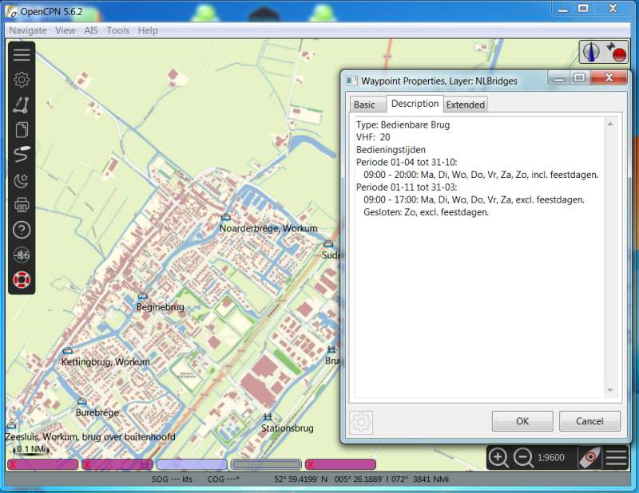
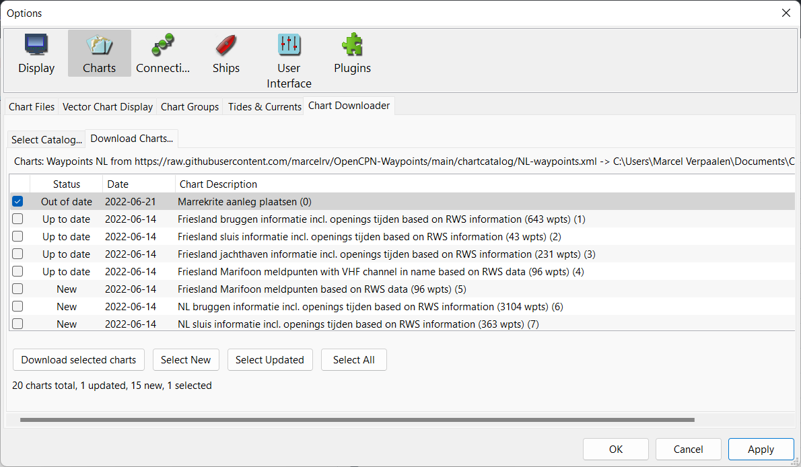

# OpenCPN-Waypoints

## GPX Files for OpenCPN

### Dutch files (boeien, bruggen, sluizen, marifoon & jachthavens gebaseerd op RWS / vaarweginformatie.nl data)
* [Friesland-Boeien.gpx](https://github.com/marcelrv/OpenCPN-Waypoints/releases/download/waypoints-latest/Friesland-Boeien.gpx) - Boeien in Friesland als GPX (bron: provincie Friesland). Note: gebruik de [usericons](https://github.com/marcelrv/OpenCPN-Waypoints/releases/download/waypoints-latest/usericons.zip)  anders zie je alleen circels
* [Marrekrite-Aanlegplaatsen.gpx](https://github.com/marcelrv/OpenCPN-Waypoints/releases/download/waypoints-latest/Marrekrite-Aanlegplaatsen.gpx)  - Alle marrekritten aanlegplaatsen for use with OpenCPN. Import as Layer so it can be easily switched on/off. **Note:** laatst bijgewerkt 28-07-2026; de bron (marrekrite.frl API) is offline, dit bestand wordt niet meer ververst tot er een nieuwe bron is
* [Friesland-Bruggen.gpx](https://github.com/marcelrv/OpenCPN-Waypoints/releases/download/waypoints-latest/Friesland-Bruggen.gpx) - Alle Friese bruggen met openingstijden en marifoon kanaal
* [Friesland-Bruggen-ExtraInfoInName.gpx](https://github.com/marcelrv/OpenCPN-Waypoints/releases/download/waypoints-latest/Friesland-Bruggen-ExtraInfoInName.gpx) - Friese bruggen met opening afmetingen en contact info in de naam (check 'Show WPT Name')
* [Friesland-Sluizen.gpx](https://github.com/marcelrv/OpenCPN-Waypoints/releases/download/waypoints-latest/Friesland-Sluizen.gpx) -Alle Friese sluizen met openingstijden en marifoon kanaal
* [Friesland-Jachthavens.gpx](https://github.com/marcelrv/OpenCPN-Waypoints/releases/download/waypoints-latest/Friesland-Jachthavens.gpx) - Jachthavens in Friesland
* [Friesland-MarifoonPunten-VHFinName.gpx](https://github.com/marcelrv/OpenCPN-Waypoints/releases/download/waypoints-latest/Friesland-MarifoonPunten-VHFinName.gpx) - Marifoon meldpunten met kanaal in de naam om snel te zien in de map (check 'Show WPT Name')
* [Friesland-MarifoonPunten.gpx](https://github.com/marcelrv/OpenCPN-Waypoints/releases/download/waypoints-latest/Friesland-MarifoonPunten.gpx) - Marifoon meldpunten Friesland
* [NL-Boeien.gpx](https://github.com/marcelrv/OpenCPN-Waypoints/releases/download/waypoints-latest/NL-Boeien.gpx) - Nederlandse Boeien (excl Friesland) als GPX (bron: RWS Friesland). Note: gebruik de [usericons](https://github.com/marcelrv/OpenCPN-Waypoints/releases/download/waypoints-latest/usericons.zip)  anders zie je alleen circels
* [NL-Bruggen.gpx](https://github.com/marcelrv/OpenCPN-Waypoints/releases/download/waypoints-latest/NL-Bruggen.gpx) - Alle Nederlandse bruggen met openingstijden en marifoon kanaal 
* [NL-Bruggen-ExtraInfoInName.gpx](https://github.com/marcelrv/OpenCPN-Waypoints/releases/download/waypoints-latest/NL-Bruggen-ExtraInfoInName.gpx) - Nederlandse bruggen met opening afmetingen en contact info in de naam (check 'Show WPT Name')
* [NL-Sluizen.gpx](https://github.com/marcelrv/OpenCPN-Waypoints/releases/download/waypoints-latest/NL-Sluizen.gpx) - Alle Nederlandse sluizen met openingstijden en marifoon kanaal 
* [NL-Jachthavens.gpx](https://github.com/marcelrv/OpenCPN-Waypoints/releases/download/waypoints-latest/NL-Jachthavens.gpx) - Jachthavens in Friesland
* [NL-MarifoonPunten-VHFinName.gpx](https://github.com/marcelrv/OpenCPN-Waypoints/releases/download/waypoints-latest/NL-MarifoonPunten-VHFinName.gpx) - Marifoon meldpunten met kanaal in de naam om snel te zien in de map (check 'Show WPT Name')
* [NL-MarifoonPunten.gpx](https://github.com/marcelrv/OpenCPN-Waypoints/releases/download/waypoints-latest/NL-MarifoonPunten.gpx) - Marifoon meldpunten Friesland

### Belgium & France (note based on information provided by RWS / vaarweginformatie.nl )
* [BE-Bruggen.gpx](https://github.com/marcelrv/OpenCPN-Waypoints/releases/download/waypoints-latest/BE-Bruggen.gpx) - Belgische bridges
* [BE-Sluizen.gpx](https://github.com/marcelrv/OpenCPN-Waypoints/releases/download/waypoints-latest/BE-Sluizen.gpx) - Belgium locks
* [FR-Bruggen.gpx](https://github.com/marcelrv/OpenCPN-Waypoints/releases/download/waypoints-latest/FR-Bruggen.gpx) - France bridges
* [FR-Sluizen.gpx](https://github.com/marcelrv/OpenCPN-Waypoints/releases/download/waypoints-latest/FR-Sluizen.gpx) - France locks

### Regional files (Friesland, Holland, Zeeland)
* [Friesland-Bruggen-ExtraInfoInName.gpx](https://github.com/marcelrv/OpenCPN-Waypoints/releases/download/waypoints-latest/Friesland-Bruggen-ExtraInfoInName.gpx) - Friese bruggen met opening afmetingen en contact info in de naam
* [Holland-Bruggen-ExtraInfoInName.gpx](https://github.com/marcelrv/OpenCPN-Waypoints/releases/download/waypoints-latest/Holland-Bruggen-ExtraInfoInName.gpx) - Holland bruggen met opening afmetingen en contact info in de naam
* [Zeeland-Bruggen-ExtraInfoInName.gpx](https://github.com/marcelrv/OpenCPN-Waypoints/releases/download/waypoints-latest/Zeeland-Bruggen-ExtraInfoInName.gpx) - Zeeland bruggen met opening afmetingen en contact info in de naam

### Germany, Austria & Swiss (note based on information provided by RWS / vaarweginformatie.nl )
* [DE-Bruggen.gpx](https://github.com/marcelrv/OpenCPN-Waypoints/releases/download/waypoints-latest/DE-Bruggen.gpx) - German bridges
* [DE-Sluizen.gpx](https://github.com/marcelrv/OpenCPN-Waypoints/releases/download/waypoints-latest/DE-Sluizen.gpx) - German locks
* [AT-Bruggen.gpx](https://github.com/marcelrv/OpenCPN-Waypoints/releases/download/waypoints-latest/AT-Bruggen.gpx) - Austria bridges
* [AT-Sluizen.gpx](https://github.com/marcelrv/OpenCPN-Waypoints/releases/download/waypoints-latest/AT-Sluizen.gpx) - Austria locks
* [CH-Bruggen.gpx](https://github.com/marcelrv/OpenCPN-Waypoints/releases/download/waypoints-latest/CH-Bruggen.gpx) - Swiss bridges

## Easy Update in OpenCPN

To support easy downloading of the latest files add the following URL to the Chart Downloader plugin:
[https://raw.githubusercontent.com/marcelrv/OpenCPN-Waypoints/main/chartcatalog/NL-waypoints.xml](https://raw.githubusercontent.com/marcelrv/OpenCPN-Waypoints/main/chartcatalog/NL-waypoints.xml)  
Note that you still need to (manually) import the waypoints in the Route and Marks manager.

## Tools
* [marrekritten_to_GPX.py](marrekritten_to_GPX.py) - File to automatically create marrekrite.gpx from the https://www.marrekrite.frl website.  
To update run `python3 marrekritten_to_GPX.py`

* [vwi_waypoints_generator.py](vwi_waypoints_generator.py) - File to automatically create the bridges, locks, radio and harbours gpx files from the public data of Rijkswaterstaat on https://www.vaarweginformatie.nl/  
To update run `python3 vwi_waypoints_generator.py`.  
To update files when no update is availabe from https://www.vaarweginformatie.nl/ run it with any argument e.g. `python3 vwi_waypoints_generator.py  -force`

* [boeien_generator.py](boeien_generator.py)  - File to automatically create the boeienfiles based on data from provincie Friesland & RWS

Requires gpxpy, you can install this with `pip3 install gpxpy` or alternatively `pip3 install -r requirements.txt`  
For boeien_generator also osgeo is required and python >=3.9

## Copyright
Provided GPX files have CC BY-NC-SA 4.0 licence... so copy them, edit them and share again... just don't sell them. They are here all free of charge.
Location data provided in these files is based on public data.

## Buy me a beer
All the files here are provided absolutely free for you to use. They are automatically updated when there is a change from RWS.  
If you like these files and they are usefull to you...I will appreciate very much you [buy me a beer](https://paypal.me/MarcelVerpaalen) and I'll promise I'll enjoy it on my next sailing trip.

## (no)Warranty
Though provided GPX files are generated based on formally published data from respective authorities, they are explicitly provided “AS IS” without express or implied warranties, guarantees, or guarantees of correctness. So USE THEM AT YOUR OWN RISK!  
Having said that... <B>HAPPY SAILING<B>
